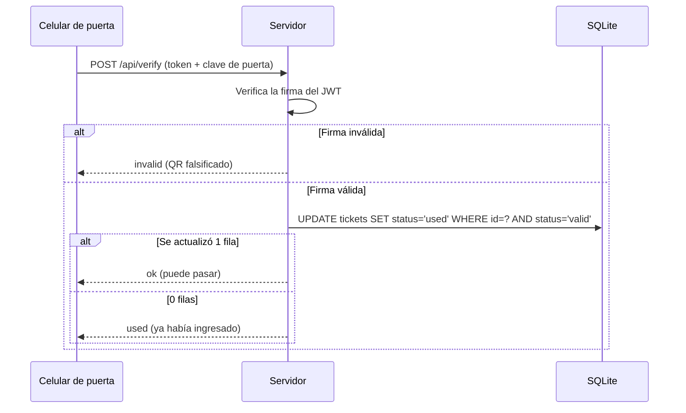

# Check-in de eventos con QR

Sistema de control de acceso para eventos: cada invitado recibe un código QR firmado y el personal de puerta lo escanea desde el celular. La validación ocurre en el servidor, así que un QR falso o ya usado se rechaza al instante, incluso con varias puertas escaneando a la vez.

**Tecnologías:** Node.js · Express · SQLite (better-sqlite3) · JWT · HTML · JavaScript

## Funcionalidades

- **Panel de administración** (`admin.html`): registrar invitados, ver quién ya ingresó, generar e imprimir los QR y deshacer un check-in hecho por error.
- **Escáner de puerta** (`scan.html`): lee el QR con la cámara del celular y muestra el resultado con colores: verde (puede pasar), ámbar (ya ingresó) o rojo (no válido).
- **Dos roles con claves separadas:** la administradora gestiona la lista; el personal de puerta solo puede verificar entradas.

## Cómo funciona la seguridad

1. **QR firmados.** Cada QR contiene un token JWT firmado (HS256) con una clave secreta del servidor. Sin esa clave nadie puede fabricar un QR válido.
2. **Identificadores aleatorios.** Cada entrada usa un ID generado con `crypto.randomBytes`, difícil de adivinar.
3. **Validación en el servidor.** El celular de la puerta solo consulta; la decisión la toma el backend.
4. **Check-in atómico.** La entrada se marca como usada con `UPDATE ... WHERE status = 'valid'`. Solo el primer escaneo modifica la fila, así que el mismo QR no sirve dos veces, ni siquiera en dos puertas al mismo tiempo.



## API

| Método | Ruta | Rol | Acción |
|---|---|---|---|
| POST | `/api/admin/guests` | Admin | Registra invitados y devuelve sus tokens |
| GET | `/api/admin/guests` | Admin | Lista invitados con su estado y totales |
| POST | `/api/admin/undo` | Admin | Revierte un check-in |
| POST | `/api/admin/reset` | Admin | Borra todos los registros |
| POST | `/api/verify` | Puerta | Verifica un QR y registra el ingreso |

La autenticación de cada rol se envía en las cabeceras `x-admin-key` o `x-door-key`.

## Ejecutar en local

Requiere Node.js 18 o superior.

```bash
npm install
QR_SECRET=una-clave-larga ADMIN_KEY=clave-admin DOOR_KEY=clave-puerta npm start
```

Luego abrir:

- Panel de administración: http://localhost:3000/admin.html
- Escáner de puerta: http://localhost:3000/scan.html

En `localhost` la cámara funciona sin HTTPS. Las variables disponibles están documentadas en `.env.example`.

## Despliegue

La cámara del celular necesita HTTPS, por eso para usarlo en un evento real hay que desplegar el servidor. Con Render (plan gratuito):

1. Crear un **Web Service** conectado a este repositorio.
2. Build command: `npm install` · Start command: `npm start`
3. Definir `QR_SECRET`, `ADMIN_KEY` y `DOOR_KEY` en **Environment** con valores propios.
4. Agregar un disco persistente (por ejemplo en `/data`) y definir `DB_PATH=/data/eventos.db` para no perder los datos al reiniciar.

## Mejoras futuras

- Hacer obligatorias las variables de entorno y detener el servidor si faltan, en lugar de usar claves por defecto.
- Comparar las claves de acceso en tiempo constante (`crypto.timingSafeEqual`).
- Limitar intentos por IP en `/api/verify` para frenar ataques de fuerza bruta.
- Migrar a PostgreSQL si el evento requiere muchas puertas o miles de invitados; la lógica de seguridad no cambia.
